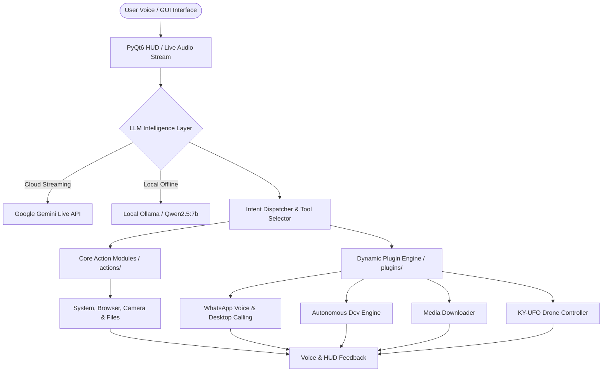

# 🤖 JARVIS — Advanced AI Assistant & Autonomous Voice Agent

[](https://www.python.org/)
[]()
[](LICENSE)
[]()

**JARVIS** is an autonomous, multi-modal personal AI assistant and voice agent built for Windows. It features real-time 2-way voice phone calls over WhatsApp Desktop, hybrid cloud/local LLM intelligence, Windows UI automation, autonomous software development, notification monitoring, media downloading, and physical/simulated drone flight control.

---

## 📑 Table of Contents

- [Overview & Architecture](#-overview--architecture)
- [Key Features](#-key-features)
  - [Cloud & Local Hybrid Intelligence](#-cloud--local-hybrid-intelligence)
  - [WhatsApp Subsystem](#-whatsapp-subsystem)
  - [Autonomous Development Engine](#-autonomous-development-engine)
  - [Speech & Audio Pipeline](#-speech--audio-pipeline)
  - [Desktop & OS Automation](#-desktop--os-automation)
  - [Media Downloader](#-media-downloader)
  - [KY-UFO Drone Flight Control](#-ky-ufo-drone-flight-control)
- [Plugin System Architecture](#-plugin-system-architecture)
- [Security & Privacy](#-security--privacy)
- [System Prerequisites](#-system-prerequisites)
- [Installation Guide](#-installation-guide)
- [Configuration](#-configuration)
- [Running JARVIS](#-running-jarvis)
- [Testing & Diagnostics](#-testing--diagnostics)
- [Project Structure](#-project-structure)
- [Troubleshooting](#-troubleshooting)
- [Roadmap](#-roadmap)
- [License](#-license)

---

## 🏛️ Overview & Architecture

JARVIS combines real-time streaming multimodal AI (Google Gemini Live) with offline local intelligence (Ollama) to execute system-level commands, process visual streams, handle communications, and autonomously plan software modifications.



### Action Dispatch Layer
JARVIS employs a two-tier execution model:
1. **Core Static Actions (`actions/`)**: Pre-compiled tools for file system manipulation, window management, screen processing, browser navigation, volume adjustment, and web search.
2. **Dynamic Plugins (`plugins/`)**: Modular, isolated Python modules discovered dynamically on startup with auto-registration and crash protection.

---

## 🌟 Key Features

### 🧠 Cloud & Local Hybrid Intelligence

* **Google Gemini Live (Cloud)**: Enables real-time, low-latency 2-way multimodal voice streaming with system function calling (`gemini-2.5-flash`).
* **Local Ollama Integration (Offline)**: Runs completely offline using local models via Ollama (`http://127.0.0.1:11434`).
  * **Default Model**: `qwen2.5:7b` (Configured in [`core/llm_client.py`](file:///F:/jarvis/core/llm_client.py) and [`memory/config_manager.py`](file:///F:/jarvis/memory/config_manager.py)).
  * Supports streaming responses, fallback handling, and custom prompt templates.

---

### 📞 WhatsApp Subsystem

The WhatsApp subsystem is a comprehensive suite for automated WhatsApp communications:

#### 1. Real-Time WhatsApp Voice Bridge (`plugins/whatsapp_voice_bridge.py`)
Initiates 2-way AI voice phone calls over WhatsApp Desktop using virtual audio routing.

```text
Remote Caller (WhatsApp)
       │
       ▼
WASAPI Loopback Capture ──► Adaptive VAD ──► Faster-Whisper STT (CUDA/CPU)
                                                     │
                                                     ▼
WhatsApp Microphone ◄── VB-Audio Cable ◄── EdgeTTS ◄── Local LLM (qwen2.5:7b)
```

* **WASAPI Loopback Capture**: Direct audio stream acquisition from WhatsApp Desktop output.
* **Adaptive Voice Activity Detection (VAD)**: Dynamic energy thresholding for instant turn-taking detection.
* **Acoustic Cooldown & Self-Echo Protection**: Prevents JARVIS from hearing its own spoken responses.
* **VB-Audio Virtual Cable Routing**: Directs synthesized TTS output into `CABLE Input` for transmission to the remote caller.

#### 2. WhatsApp Desktop Calling Automation (`plugins/whatsapp_desktop_call.py`)
Provides automated phone and video call placement via Windows UI Automation (`uiautomation`):
* **Dynamic Control Tree Scanning**: Discovers WhatsApp search boxes, chat headers, voice call, and video call controls dynamically without rigid pixel offsets.
* **Multi-Layer Fallbacks**: Keyboard navigation (`Ctrl+F`, `Tab`, `Enter`) and visual coordinate detection fallbacks.
* **DPI & Window Bounds Handling**: Robust call verification across multi-monitor setups and dynamic DPI scaling.

#### 3. WhatsApp Notification Monitor (`plugins/whatsapp_monitor.py`)
* Listens to incoming Windows toast notifications using Windows Runtime (`winrt.windows.ui.notifications`).
* Generates contextual responses using Gemini / Ollama.
* Optional, safety-gated automated reply dispatch (disabled by default).

#### 4. WhatsApp Message History (`plugins/whatsapp_message_history.py` & `core/whatsapp_history/`)
* Captures and stores local WhatsApp chat transcripts in a local SQLite database (`memory/whatsapp_history.db`).
* Query interface allowing JARVIS to retrieve prior message history, search by contact, and analyze past conversations.

---

### 🤖 Autonomous Development Engine (`core/autonomous/` & `plugins/jarvis_autonomous.py`)

An approval-first, self-correcting software development engine for code analysis, task planning, and automated implementation:

```text
Inspect Repo ──► Create Plan ──► [User Approval Gate] ──► Git Checkpoint
                                                               │
                                                               ▼
Complete ◄── Verify Tests ◄── [User Approval Gate] ◄── Implement Changes
```

* **Approval-First Lifecycle**: Every autonomous change requires explicit user confirmation before code modification.
* **Safety Checkpoints & Rollbacks**: Creates git state snapshots before applying edits, enabling instant rollback if tests fail.
* **Diagnostic Loop**: Executes unit tests, parses failure tracebacks, formulates targeted repair plans, and re-tests until resolved.
* **Controlled Isolation**: Restricts edits to authorized workspace directories.

---

### 🎙️ Speech & Audio Pipeline

#### Speech-to-Text (STT) (`core/stt.py`)
* **Engine**: `faster-whisper` (CTranslate2 backend).
* **GPU Acceleration**: Native CUDA 12 support for RTX GPUs (`float16`).
* **CPU Fallback**: Graceful fallback to `int8` CPU quantization when CUDA is unavailable.
* **Offline STT**: Support for Vosk offline engine for lightweight transcription.

#### Text-to-Speech (TTS) (`core/tts.py`)
* **Engine**: `edge-tts` (Microsoft Edge Neural Voices) and `pyttsx3` offline fallback.
* **Audio Device Routing**: Configurable output routing (`TTS_OUTPUT_DEVICE`) to switch between physical speakers and virtual cables.
* **Dynamic Resampling**: Automatic audio interpolation to match device sample rates (e.g. 24kHz to 48kHz WASAPI).

---

### 🖥️ Desktop & OS Automation (`actions/`)

* **Window & Application Control**: Launch apps, list active windows, manage window state (`open_app.py`, `desktop.py`, `computer_control.py`).
* **Protected File System Management**: Sandboxed file creation, read, write, and deletion with critical system directory safeguards (`actions/file_controller.py`).
* **Browser Automation**: Playwright-backed browser control for automated web navigation, data extraction, and search (`browser_control.py`, `web_search.py`).
* **Media Control**: YouTube search, playback controls, and system volume control (`youtube_video.py`, `computer_settings.py`).
* **Vision & Screen Processing**: Screen capture, OCR, and vision analysis with Gemini Live integration (`screen_processor.py`).

---

### 📥 Media Downloader (`plugins/media_downloader.py`)

Multi-platform streaming media downloader plugin:
* **Async Downloads**: Non-blocking streaming downloads with real-time progress tracking.
* **Path Validation & SSRF Protection**: Restricts output directory to `downloads/` and validates destination URLs against internal network probing.
* **Legal & Authorized Use Focus**: Operates without DRM bypass or paywall circumvention.

---

### 🚁 KY-UFO Drone Flight Control (`plugins/ky_ufo_drone.py`)

Offline simulation and hardware UDP packet flight controller for KY-UFO drones:
* **Protocol**: UDP packet transmission (`7099/UDP`) with 20Hz heartbeat loop.
* **Flight Controls**: Takeoff, land, hover, trim, roll, pitch, yaw, and emergency stop.
* **Modes**: Switchable between `REAL` hardware transmission and `SIMULATION` mode.
* **Calibration Sequence**: Gyroscope auto-calibration and pre-flight countdown sequence.

---

## 🧩 Plugin System Architecture

Plugins are modular components stored in [`plugins/`](file:///F:/jarvis/plugins). The loader (`core/plugin_loader.py`) discovers and registers plugins at runtime:

```python
# Standard Plugin Spec Structure
PLUGIN = {
    "name": "example_plugin",
    "description": "Performs custom automated tasks.",
    "parameters": {
        "type": "OBJECT",
        "properties": {
            "query": {"type": "STRING", "description": "Input prompt."}
        },
        "required": ["query"]
    }
}

def run(parameters: dict, player=None, session_memory=None) -> str:
    """Plugin entry point invoked by JARVIS."""
    query = parameters.get("query", "")
    return f"Processed query: {query}"
```

### Registration Features
* **Dynamic Loading**: Loads `.py` files in `plugins/` without modifying core code.
* **Collision Protection**: Prevents overriding built-in core actions.
* **Crash Isolation**: Exceptions inside plugins are caught gracefully without terminating main runtime loop.

---

## 🔒 Security & Privacy

1. **Path Protection & Sandboxing**: `actions/file_controller.py` blocks operations targeting system directories (`C:\Windows`, `C:\Program Files`, `/etc`, `/usr/bin`).
2. **Secret & Local Data Exclusion**: `.gitignore` ensures sensitive files (`config/api_keys.json`, `.env`, `*.db`, `.autonomous/`) are excluded from Git.
3. **Local Intelligence Option**: Complete offline operation via Ollama (`qwen2.5:7b`) ensures no voice or text data leaves the local machine.
4. **Approval-First Autonomous Operations**: Code modifications require explicit human confirmation.
5. **SSRF Prevention**: Media downloader validates target URLs to prevent local network scanning.

---

## 💻 System Prerequisites

| Component | Minimum Requirement | Recommended |
|---|---|---|
| **Operating System** | Windows 10/11 (64-bit) | Windows 11 (64-bit) |
| **Python** | Python 3.10+ | Python 3.14.4 |
| **GPU Acceleration** | CPU (Supported) | NVIDIA GPU (CUDA 11/12) for faster-whisper |
| **Virtual Audio** | Required for WhatsApp Bridge | [VB-Audio Virtual Cable](https://vb-audio.com/Cable/) |
| **Local LLM** | Ollama Server | [Ollama](https://ollama.com/) with `qwen2.5:7b` |

---

## 🛠️ Installation Guide

### 1. Clone the Repository

```powershell
git clone https://github.com/i-amshifa-06/Jarvis.git
cd Jarvis
```

### 2. Set Up Virtual Environment

```powershell
python -m venv venv
.\venv\Scripts\activate
```

### 3. Install Dependencies

```powershell
pip install -r requirements.txt
```

> **For PyTorch with CUDA (NVIDIA GPU Acceleration)**:
> ```powershell
> pip install torch torchaudio --index-url https://download.pytorch.org/whl/cu121
> ```

### 4. Install Playwright Browsers

```powershell
python -m playwright install
```

---

## ⚙️ Configuration

1. Copy the example configuration template:
   ```powershell
   Copy-Item config\api_keys.json.example config\api_keys.json
   ```

2. Edit `config/api_keys.json`:
   ```json
   {
       "gemini_api_key": "YOUR_GEMINI_API_KEY",
       "os_system": "windows",
       "camera_index": 0,
       "llm_provider": "ollama",
       "llm_model": "qwen2.5:7b",
       "llm_url": "http://localhost:11434",
       "assistant_name": "JARVIS",
       "user_name": "Sir",
       "voice_name": "Fenrir",
       "plugins_enabled": {
           "whatsapp_monitor": true,
           "whatsapp_voice_bridge": true,
           "jarvis_autonomous": true
       }
   }
   ```

---

## 🦙 Ollama Local Setup

1. Install Ollama from [ollama.com](https://ollama.com).
2. Pull the default `qwen2.5:7b` model:
   ```powershell
   ollama pull qwen2.5:7b
   ```
3. Verify Ollama server status:
   ```powershell
   curl http://localhost:11434/api/tags
   ```

---

## 🎧 VB-Audio Cable Setup (for WhatsApp Voice Bridge)

To enable 2-way AI calls over WhatsApp Desktop:
1. Install [VB-Audio Virtual Cable](https://vb-audio.com/Cable/).
2. Open **WhatsApp Desktop** -> **Settings** -> **Audio & Video**:
   * **Microphone**: `CABLE Output (VB-Audio Virtual Cable)`
   * **Speakers**: Default Headphones / Physical Speakers

---

## 🚀 Running JARVIS

### 1. Launch Main Application & PyQt6 HUD
```powershell
python main.py
```

### 2. Launch Autonomous WhatsApp Voice Bridge Directly
```powershell
python live_test_bridge.py "<contact_name>" --debug-audio
```

---

## 🧪 Testing & Diagnostics

JARVIS includes a full suite of **177 automated unit tests**:

```powershell
$env:PYTHONPATH="venv\Lib\site-packages;."
pytest
```

### Test Suite Breakdown

| Category / Test File | Description | Status / Count |
|---|---|---|
| `test_whatsapp_voice_bridge.py` | Audio loopback, VAD energy adapt, echo rejection | **31 Passed** |
| `test_whatsapp_desktop_call.py` | UIA window capture, element discovery | **10 Passed** |
| `test_whatsapp_desktop_logic.py` | UI automation state machine, call fallbacks | **69 Passed** |
| `test_whatsapp_message_history.py` | Local SQLite storage & history queries | **24 Passed** |
| `test_whatsapp_monitor.py` | Toast notification handling & parsing | **6 Passed** |
| `test_jarvis_autonomous.py` | Autonomous planning, checkpoints, approval gates | **14 Passed** |
| `test_media_downloader.py` | Stream downloading, SSRF checks, path security | **12 Passed** |
| `test_ky_ufo_drone.py` | Drone UDP packet generation, telemetry, calibration | **4 Passed** |
| `test_pushup_counter.py` | Pose estimation & vision overlay logic | **3 Passed** |
| `test_upload_video.py` | Video processing & upload action tests | **4 Passed** |
| **Total** | **Comprehensive Test Suite** | **177 Passed** |

---

## 📁 Project Structure

```text
Jarvis/
├── main.py                          # Application entry point & Gemini Live loop
├── ui.py                            # PyQt6 HUD interface & visualizer
├── setup.py                         # Environment configuration wizard
├── live_test_bridge.py              # WhatsApp Voice Bridge runner script
├── requirements.txt                 # Dependencies manifest
├── LICENSE                          # MIT License file
├── README.md                        # Documentation
├── actions/                         # Core static system action modules
│   ├── file_controller.py           # Path-sanitized file operations
│   ├── screen_processor.py          # Screen capture & vision processing
│   ├── browser_control.py           # Playwright browser integration
│   ├── computer_control.py          # System process & window manager
│   ├── computer_settings.py         # Volume & setting controls
│   ├── desktop.py                   # Desktop management
│   ├── open_app.py                  # Application launcher
│   ├── system_monitor.py            # Hardware telemetry & status
│   ├── web_search.py                # Search engine integration
│   └── youtube_video.py             # YouTube playback controls
├── core/                            # Core system services
│   ├── llm_client.py                # Ollama & OpenAI API streaming client
│   ├── stt.py                       # Faster-Whisper (CUDA) & Vosk STT
│   ├── tts.py                       # EdgeTTS & audio device player
│   ├── plugin_loader.py             # Dynamic plugin discovery & isolation
│   ├── autonomous/                  # Autonomous engine framework
│   │   ├── engine.py                # Main execution loop
│   │   ├── planner.py               # Task decomposition
│   │   ├── policy.py                # Security & approval policy
│   │   ├── checkpoint.py            # Git state snapshots
│   │   ├── diagnostics.py           # Test output analysis
│   │   └── rollback.py              # State restoration
│   └── whatsapp_history/            # WhatsApp chat history database
│       ├── models.py                # Database schemas
│       ├── query.py                 # Search & retrieval functions
│       └── storage.py               # SQLite storage manager
├── plugins/                         # Dynamic plugin extensions
│   ├── whatsapp_voice_bridge.py     # 2-Way audio call bridge & VAD
│   ├── whatsapp_desktop_call.py     # Windows UIA call automation
│   ├── whatsapp_monitor.py          # WinRT notification listener
│   ├── whatsapp_message_history.py  # Local message query plugin
│   ├── jarvis_autonomous.py         # Autonomous developer plugin
│   ├── media_downloader.py          # Sandboxed media downloader
│   ├── ky_ufo_drone.py              # Drone UDP flight controller
│   ├── pushup_counter.py            # Computer vision exercise tracker
│   └── upload_video.py              # Automated video uploader
├── config/                          # Configuration files
│   └── api_keys.json.example        # Configuration template
├── memory/                          # Persistent local storage
│   └── config_manager.py            # Application settings manager
├── docs/                            # Deep-dive investigation & UIA docs
└── tests/                           # Unit test suite (177 tests)
```

---

## ❓ Troubleshooting

### Ollama Connection Issues
* **Error**: `LLM connection refused (11434)`.
* **Fix**: Ensure Ollama is running (`ollama serve`) and the model is pulled (`ollama pull qwen2.5:7b`).

### WhatsApp UI Automation Failures
* **Error**: `WhatsApp Desktop window not found`.
* **Fix**: Ensure WhatsApp Desktop is open and visible on screen (not minimized to system tray).

### Audio Routing Issues
* **Error**: Remote caller cannot hear JARVIS voice.
* **Fix**: Check WhatsApp Desktop Audio settings and verify **Microphone** is set to `CABLE Output (VB-Audio Virtual Cable)`.

---

## 🗺️ Roadmap

### Planned / Future Enhancements
* [ ] Multi-turn multimodal image & video screen analysis in live loop.
* [ ] Cross-platform support (Linux / macOS UI Automation support).
* [ ] Plugin marketplace and dynamic dependency installation.
* [ ] Enhanced long-term vector-memory database integration.

---

## 📜 License

Distributed under the **MIT License**. See [`LICENSE`](LICENSE) for details.

---

### Repository
[https://github.com/i-amshifa-06/Jarvis.git](https://github.com/i-amshifa-06/Jarvis.git)
